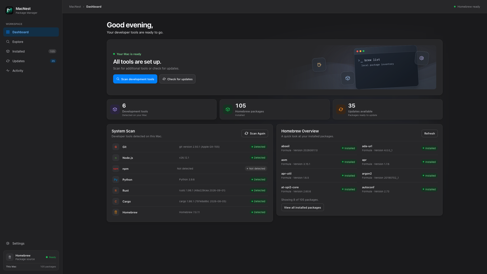
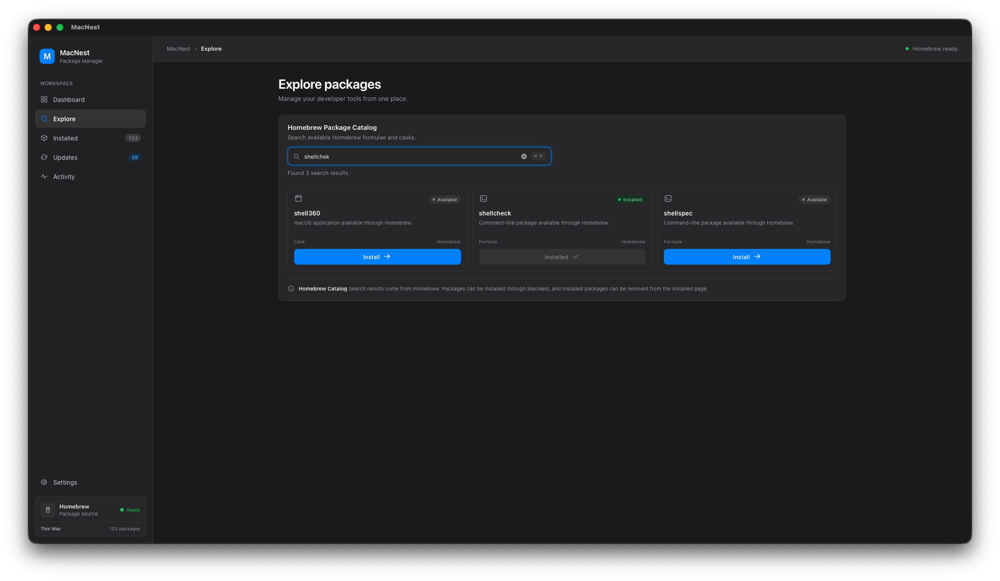

🪺 MacNest

A modern package manager for macOS developers.

Manage your developer tools, discover Homebrew packages, track downloads, and keep your development environment organized — all from one native-style macOS application.

⸻

✨ Overview

MacNest is a desktop application designed to simplify package management on macOS. Built with Tauri, React, TypeScript, and Rust, it combines a modern interface inspired by native macOS design with the power of Homebrew.

Instead of managing everything through terminal commands, MacNest aims to provide a convenient graphical interface for discovering packages, managing installed tools, monitoring downloads, and reviewing available updates.

🚀 Features

- 🏠 Dashboard — Access your development environment and package management overview.
- 🔍 Explore Packages — Search the Homebrew catalog to discover available formulae and casks.
- 📦 Installed Packages — View and manage installed development tools.
- ⬇️ Download Progress — Monitor package installation progress.
- 🔄 Updates — Review available package updates and manage your update workflow.
- 📋 Activity Tracking — Review package management activities.
- 🖥️ System Scan — Discover development tools available on your Mac.
- 🎨 Native macOS-Inspired UI — Clean layouts, familiar controls, and system appearance support.
- 🌗 Light and Dark Appearance — Adapt the interface to your preferred system appearance.
- ⚡ Desktop Performance — Use a lightweight desktop architecture powered by Tauri and Rust.

Note: Available features depend on the current implementation. Package installation, update detection, progress reporting, and system scanning may depend on Homebrew and your local environment.

🛠️ Tech Stack

Technology Purpose
Tauri 2 Desktop application framework
React User interface
TypeScript Type-safe frontend development
Vite Frontend development and production builds
Rust Native backend functionality
Homebrew macOS package management

📸 Screenshots

Add screenshots of your actual application here to showcase its interface.

For example:

docs/
└── screenshots/
├── dashboard.png
├── explore.png
├── installed.png
└── settings.png

Once you add these images to your repository, display them in this section:

### Dashboard

### Explore Packages

📋 Requirements

Before running MacNest from source, make sure you have:

- macOS
- Node.js and npm
- Rust and Cargo
- Homebrew
- The development prerequisites required by Tauri for macOS

Useful installation resources:

- Node.js
- Rust
- Homebrew
- Tauri prerequisites

📥 Installation

Option 1: Download MacNest

Download the latest available macOS installer from GitHub Releases.

1. Download the .dmg file compatible with your Mac.
2. Open the downloaded disk image.
3. Follow the installation instructions.
4. Launch MacNest from your Applications folder.

The macOS build command below creates a universal DMG for Apple Silicon and Intel Macs. A universal build requires both Rust targets (`aarch64-apple-darwin` and `x86_64-apple-darwin`). The default ad-hoc signature is suitable for local sharing tests, but macOS may still block downloaded copies. To distribute without Gatekeeper warnings, sign with an Apple Developer ID Application certificate and notarize the DMG. Configure `APPLE_SIGNING_IDENTITY` and Apple notarization credentials as described in the [Tauri macOS signing guide](https://tauri.app/distribute/sign/macos/).

Option 2: Run from Source

Prerequisites

Before running MacNest, install:

- Node.js and npm
- Rust and Cargo
- Homebrew
- Tauri prerequisites for macOS

Clone the Repository

git clone https://github.com/RaninduAmarasinghe/MacNest.git
cd MacNest

Install Dependencies

npm install

Start Development Mode

npm run tauri dev

This starts the frontend development server and launches the MacNest desktop application.

Build for Production

npm run build:macos

The generated application and installer bundles are available under:

src-tauri/target/release/bundle/

The universal macOS DMG is written under `src-tauri/target/universal-apple-darwin/release/bundle/dmg/`.

⸻

🛠️ Development

MacNest is built using modern technologies to provide a desktop package management experience for macOS.

Technology Stack

Tauri 2
Provides the native desktop application framework.

React
Powers the application’s user interface.

TypeScript
Provides type safety and improves code maintainability.

Vite
Handles frontend development and production builds.

Rust
Powers native functionality and communicates with the operating system.

Homebrew
Provides the package catalog and package management functionality.

How MacNest Works

MacNest combines a React frontend with a Rust backend through Tauri.

* The frontend displays the dashboard, package catalog, installed packages, updates, and activity.
* The Rust backend handles native application operations.
* Homebrew provides access to available packages and installation commands.
* Tauri connects the frontend to the native backend.

Project Organization

The project is organized into the following main areas.

Frontend — src/

Contains the React and TypeScript code responsible for the user interface.

Static Assets — public/

Contains static files used by the frontend.

Native Application — src-tauri/

Contains the Rust backend and Tauri configuration.

Important files include:

* src-tauri/src/ — Native Rust application code.
* src-tauri/icons/ — Application icons.
* src-tauri/Cargo.toml — Rust dependencies and project configuration.
* src-tauri/tauri.conf.json — Tauri application configuration.

Project Configuration

* package.json — Frontend dependencies and npm scripts.
* tsconfig.json — TypeScript configuration.
* README.md — Project documentation.

Development Commands

Install dependencies

Run this command from the project root:

npm install

Start the development application

npm run tauri dev

Build the production application

npm run build:macos

The universal macOS application and installer are available under:

src-tauri/target/universal-apple-darwin/release/bundle/

⸻

🗺️ Roadmap

Potential future improvements include:

- Publish the first public release.
- Improve package search and filtering.
- Add package details and dependency information.
- Improve installation and uninstallation feedback.
- Enhance download progress reporting.
- Improve update management.
- Add package categories and favorites.
- Add application signing and notarization.
- Expand documentation and automated testing.

Roadmap items may change as development progresses.

🤝 Contributing

Contributions, bug reports, and feature suggestions are welcome.

1. Fork the repository.
2. Create a feature branch:

git checkout -b feature/your-feature

3. Commit your changes:

git commit -m "feat: add your feature"

4. Push your branch:

git push origin feature/your-feature

5. Open a pull request describing your changes.

For substantial changes, consider opening an issue first to discuss your proposal.

🐛 Reporting Issues

Found a bug or have an idea?

Open an issue in the MacNest GitHub repository.

Include relevant details, reproduction steps, and error messages when possible.

🔒 Security

MacNest interacts with local package-management tools. Review installation commands and package sources carefully.

Please report security vulnerabilities privately rather than publishing sensitive exploit details in public issues.

📄 License

MacNest is intended to use the MIT License.

Before distributing the project under this license, add a LICENSE file containing the appropriate MIT License text and confirm that the project’s dependencies and assets permit your intended distribution.

👨‍💻 Author

Ranindu Amarasinghe

- GitHub: @RaninduAmarasinghe

⸻

Built for developers who love macOS. 🍎

⭐ If you find MacNest useful, consider starring the repository!

